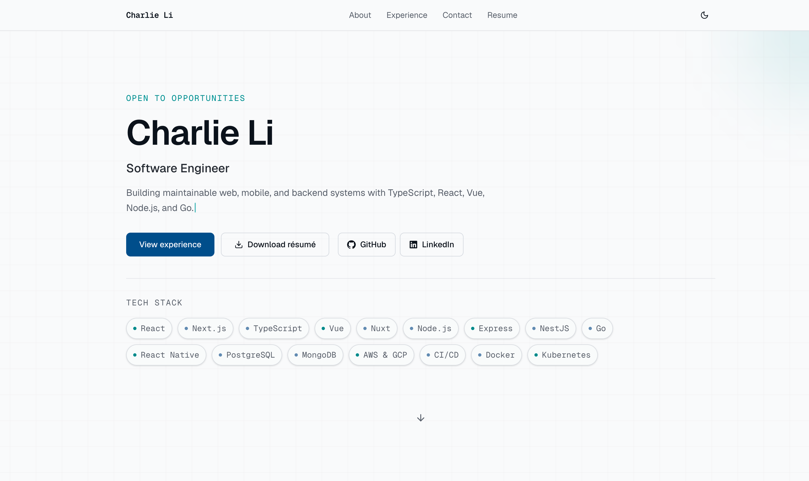
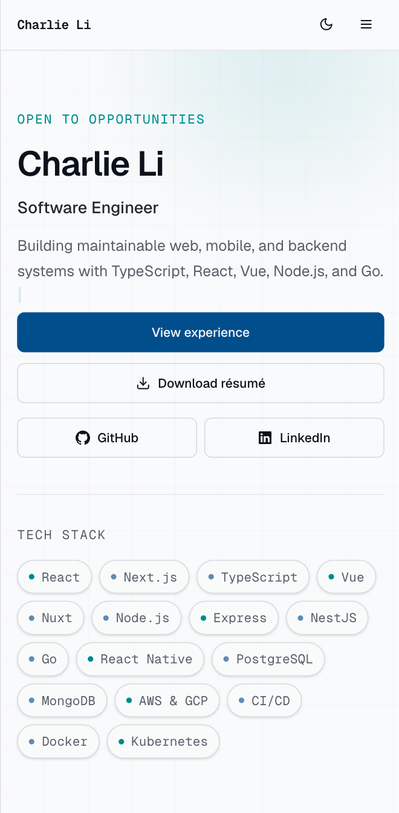

# Charlie Li — Software Engineer Portfolio

[](https://github.com/lichuangqi/personal_website/actions/workflows/ci.yml)

The source for [chuangqili.com](https://chuangqili.com), my professional portfolio and online résumé. It is designed for a fast recruiter journey: understand my positioning, scan evidence from commercial work, download the current résumé, and get in touch.

<p align="center">
  <a href="https://chuangqili.com"><strong>Live Demo</strong></a>
  ·
  <a href="https://chuangqili.com/resume/Chuangqi-Li-Software-Engineer-Resume.pdf"><strong>Download Résumé</strong></a>
</p>

<p align="center">
  
  
</p>

## What it demonstrates

- A responsive, accessible portfolio built with the Next.js App Router and React Server Components
- Recruiter-focused work history sourced from the current résumé
- A downloadable PDF résumé with a stable public URL
- A validated contact workflow using Server Actions, Zod, and Resend
- Search and social metadata through canonical URLs, Open Graph imagery, JSON-LD, robots.txt, and sitemap.xml
- Automated unit, end-to-end, lint, and production-build checks in GitHub Actions
- AWS Amplify deployment with a custom Route 53 domain

## Technology

- **Application:** Next.js 16, React 19, TypeScript
- **UI:** Tailwind CSS 4, Motion, responsive design tokens, light/dark themes
- **Backend:** Next.js Server Actions, Zod, Resend
- **Quality:** ESLint, Vitest, Playwright, GitHub Actions
- **Hosting:** AWS Amplify and Route 53

## Architecture

```text
src/
├── app/              # Routes, metadata, robots, sitemap, social image
├── actions/          # Server actions
├── components/
│   ├── layout/       # Header, footer, theme, page primitives
│   ├── sections/     # Recruiter-facing page sections
│   ├── shared/       # Reusable presentation components
│   └── ui/           # Base controls
├── config/           # Site metadata and navigation
├── content/          # Profile and experience copy
├── lib/              # Validation, email, and utilities
└── styles/           # Design tokens and global styles

tests/e2e/            # Recruiter-journey and metadata smoke tests
public/resume/        # Current downloadable résumé
```

The site keeps résumé-derived content in `src/content/` so career updates do not require restructuring page components.

## Engineering decisions

- Career content is separated from presentation components so résumé updates remain small and reviewable.
- The location panel is rendered locally without a third-party map API, avoiding keys, tracking, and an unnecessary client dependency.
- Contact submissions use Server Actions with server-side Zod validation, HTML escaping, and a honeypot field.
- Motion effects are responsive, run once where appropriate, and respect the operating system's reduced-motion preference.
- Metadata routes, JSON-LD, canonical URLs, and generated Open Graph imagery keep search and social previews consistent.
- Vitest covers validation logic while Playwright checks the complete recruiter journey on desktop and mobile.

## Local development

Requirements: Node.js 20 or newer.

```bash
npm ci
cp .env.example .env.local
npm run dev
```

Open [http://localhost:3000](http://localhost:3000).

### Environment variables

| Variable | Required | Purpose |
| --- | --- | --- |
| `RESEND_API_KEY` | Contact delivery | Resend API key used only on the server |
| `CONTACT_TO_EMAIL` | Optional | Destination inbox for enquiries |
| `RESEND_FROM` | Optional | Verified sender identity |

Without `RESEND_API_KEY`, the site remains usable but contact-form delivery returns a configuration message.

## Quality checks

```bash
npm run lint
npm test
npm run build
npm run test:e2e
```

Vitest covers server-side form validation, including the anti-bot honeypot. Playwright verifies the main recruiter journey on desktop and mobile and checks generated metadata routes. GitHub Actions runs linting, unit tests, production builds, and Chromium end-to-end tests for pushes and pull requests.

## Deployment

AWS Amplify builds the Next.js application from `amplify.yml`. Resend variables configured in Amplify are written into the server build environment because Amplify does not automatically expose console variables to Next.js SSR runtimes.

The production site is available at [https://chuangqili.com](https://chuangqili.com).

## Content updates

When the résumé changes:

1. Replace `public/resume/Chuangqi-Li-Software-Engineer-Resume.pdf`.
2. Update `src/content/profile.ts` and `src/content/experience.ts`.
3. Run all quality checks before deployment.

## License

The source is available for portfolio review. Personal content, résumé details, and branding remain copyright Charlie Li.
